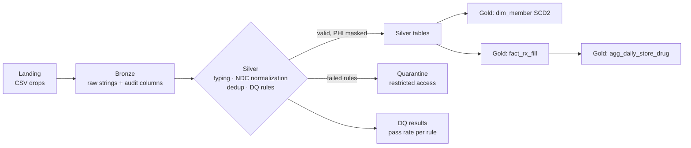

# Pharmacy Medallion Lakehouse


  

A production-style **Bronze → Silver → Gold** lakehouse for pharmacy prescription data, built with **PySpark and Delta Lake** and designed to run on **Azure Databricks**. It covers the hard parts of regulated healthcare data: NDC standardization, rule-based data quality with quarantine, **HIPAA-style PHI de-identification**, idempotent reprocessing, and an **SCD Type 2** member dimension.

> All data is **synthetic** and generated by this repo. No real patient information is used.

## Why I built this

Pharmacy data is messy in very specific ways: the same drug code shows up in different formats, files get resent, and patient details have to be protected at every step. I wanted one project that handles all of that end to end, the way a real pipeline has to, instead of a clean demo that skips the hard parts. The parts I cared most about were making bad records visible instead of silently dropping them, and making sure the pipeline can be rerun safely without creating duplicates.

## Architecture



| Layer | What happens |
|---|---|
| **Bronze** | Files land unchanged (all strings) with `_source_file`, `_ingested_at`, `_batch_id` for lineage and replay. |
| **Silver** | Type casting, **NDC normalization** (4-4-2 / 5-3-2 / 5-4-1 → 11-digit 5-4-2), latest-record dedup, **declarative DQ rules**, PHI masking. |
| **Quarantine** | Rows that fail `error` rules, with the list of failed rules on each row, kept in a restricted schema. |
| **Gold** | `dim_member` (SCD Type 2), `fact_rx_fill`, and `agg_daily_store_drug` for reporting. |

## Key engineering features

- **Data quality as configuration.** Rules are Spark SQL expressions (`Rule("ndc_valid_11_digit", "ndc11 IS NOT NULL")`). `error` rules quarantine rows, `warn` rules flag them, and every run writes a pass-rate table for monitoring.
- **PHI de-identification.** Member IDs become salted SHA-256 keys, DOB becomes birth year, ZIP becomes ZIP3, and names are dropped before Silver. On Databricks the salt is read from a **Key Vault-backed secret scope**.
- **SCD Type 2 with Delta MERGE.** A single MERGE with a staged union expires changed rows and inserts new versions. A pure-DataFrame implementation with identical behavior runs locally and in tests.
- **Idempotent batches.** Every layer uses dynamic partition overwrite by batch, so re-running a day never duplicates data (verified in the end-to-end test).
- **Governance.** `databricks/unity_catalog_grants.sql` separates engineer, analyst, and data-steward access, so analysts only ever see de-identified Gold data.
- **Deployable.** Packaged as a wheel with entry points used by the Databricks Workflows job in `databricks/job.json` (Bronze → Silver → Gold tasks with retries and alerts).

## Sample run (local, synthetic data)

Two daily batches of 5,000 fills each, including injected bad records and re-sent duplicates:

| Batch | Raw fills | After dedup | Valid | Quarantined | Members (SCD2 history rows) |
|---|---|---|---|---|---|
| day1 | 5,100 | 5,000 | 4,659 | 341 | 500 current |
| day2 | 5,100 | 5,000 | 4,715 | 285 | 50 expired versions created |

Data-quality results for day1 (from the `dq_results` table):

| Rule | Failed rows | Pass rate |
|---|---|---|
| member_id_present | 102 | 97.96% |
| ndc_valid_11_digit | 114 | 97.72% |
| prescriber_npi_10_digit | 63 | 98.74% |
| quantity_positive | 62 | 98.76% |

## Run it locally

Requires Python 3.10+ and Java 17.

```bash
pip install -r requirements.txt

# generate two days of synthetic data
PYTHONPATH=src python -m pharmacy_lakehouse.generate_data --out data

# run the pipeline (USE_DELTA=1 uses Delta Lake; USE_DELTA=0 uses Parquet, no extra jars)
PYTHONPATH=src USE_DELTA=1 python -m pharmacy_lakehouse.pipeline --data-dir data --batch day1
PYTHONPATH=src USE_DELTA=1 python -m pharmacy_lakehouse.pipeline --data-dir data --batch day2

# tests (unit + end-to-end)
pytest -q
```

## Run on Azure Databricks

1. Build the wheel: `pip wheel . -w dist --no-deps`, and upload it to a Unity Catalog volume or workspace files.
2. Create a secret scope backed by Azure Key Vault (`kv-pharmacy`) with the key `phi-hash-salt`.
3. Import `databricks/job.json` as a Workflows job, set `data_dir` to your ADLS Gen2 path, and attach the wheel.
4. Run `databricks/unity_catalog_grants.sql` to set up catalogs, schemas, and access.

## What I'd do differently in production

- **Alert on quarantine spikes.** A sudden jump in rejected rows usually means an upstream change, so I'd alert when the quarantine rate goes above a normal range instead of only reporting it.
- **Use Unity Catalog for access control.** Column masks and row filters would protect sensitive fields at the platform level, not only in pipeline code.
- **Ingest with Auto Loader.** Incremental file pickup with schema tracking instead of batch CSV reads.
- **Keep secrets in Azure Key Vault.** Any keys or salts used for de-identification would come from a secret scope, never from config files.
- **Deploy with Databricks Asset Bundles.** Jobs, clusters, and permissions versioned and promoted through dev, test, and prod.

## Project structure

```
src/pharmacy_lakehouse/
  generate_data.py   synthetic members, providers, fills with injected DQ issues
  bronze.py          raw ingest + audit columns
  silver.py          standardization, DQ rules, quarantine, PHI masking
  gold.py            SCD2 dimension, fact table, daily aggregates
  quality.py         declarative rule engine + DQ summary
  transforms.py      NDC normalization, dedup, PHI masking, record hashing
  scd2.py            SCD Type 2 (Delta MERGE and DataFrame implementations)
  pipeline.py        end-to-end runner with run metrics
databricks/          Workflows job definition, Unity Catalog grants
tests/               unit tests + two-batch end-to-end test
```

## Tech stack

PySpark · Spark SQL · Delta Lake · Azure Databricks · Databricks Workflows · Unity Catalog · Azure Key Vault · ADLS Gen2 · pytest · GitHub Actions
